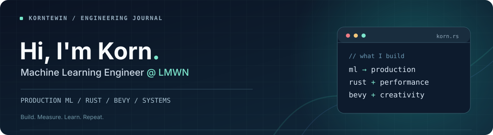

  

   

  **Machine Learning Engineer @ LMWN** · **Rust enthusiast** 🦀 · **Bevy game dev** 🎮 · **Trading bot tinkerer** 📈

   

  
  
  

## 👋 A little about me

I'm **Korn**, a machine learning engineer at **LMWN** who enjoys the intersection of **production ML, software engineering, and systems design**.

I like making ML systems not only accurate, but also **fast, efficient, and reliable in production**. My work and interests span model serving, large-scale data processing, backend systems, and cloud infrastructure.

Beyond my day job, you'll probably find me exploring **Rust**, making games with **[Bevy](https://bevyengine.org/)**, or experimenting with **crypto trading bots**.

---

## ✍️ Featured writing: RIIR — Go → Rust for ML prediction

**[RIIR: Rewriting a Production ML Prediction Service from Go to Rust →](https://korntewin.github.io/intro-website/blog/riir-rust-prediction-service/)**

A behind-the-scenes engineering story from **LMWN**: how rethinking memory layout, data movement, preprocessing, and concurrency helped our production recommendation ranker use fewer resources and respond faster.

| **5.4×** | **2.4×** | **1.9×** |
| :---: | :---: | :---: |
| Lower max pod CPU usage | Better P99 server latency | Lower max pod memory usage |

Measured in an 18-hour production A/B test with evenly split traffic. Figures are median per-minute Go/Rust ratios for this workload, not a general claim that Rust is always faster.

**Under the hood:** Rust · Apache Arrow · Polars · ONNX Runtime · Memory layout · Concurrency

**[Read the engineering deep dive →](https://korntewin.github.io/intro-website/blog/riir-rust-prediction-service/)**

---

## 🚀 Selected projects

| Project | What's interesting |
| :--- | :--- |
| **[YOLOv8 × Rust WASM](https://github.com/korntewin/yolo-wasm)** | Client-side object detection with Rust, Candle, WebAssembly, and React. |
| **[YOLOv8 × Yew](https://github.com/korntewin/yolo-wasm-yew)** | A Rust-first, browser-based ML inference experiment using Yew and WASM. |
| **[GPT Tokenizer Analyzer](https://github.com/korntewin/gpt-tkn-analyzer)** | A closer look at multilingual representation and tokenization bias. |
| **[Portfolio & Engineering Blog](https://github.com/korntewin/intro-website)** | My portfolio, technical writing, and engineering notes — built with Astro and Svelte. |

---

## 🛠️ Tools I reach for

**Languages**

**ML, data & systems**

PyTorch · ONNX Runtime · Apache Arrow · Polars · PySpark · Databricks · FastAPI · Actix Web

**Cloud & infrastructure**

Kubernetes · Docker · Terraform · AWS · Azure · GCP · CI/CD

---

## 🧪 After hours

- **🦀 Rust & performance engineering** — Exploring lower-level systems, concurrency, and efficient software.
- **🎮 Game development with [Bevy Engine](https://bevyengine.org/)** — Learning and building with Rust's data-driven Entity Component System (ECS).
- **📈 Crypto trading bots** — Experimenting with algorithmic strategies, market data, and automation.

I like building things that blend **performance, creativity, and curiosity**.

<b>🏅 Certificates & credentials</b> (click to expand)

 

---

**Build. Measure. Learn. Repeat.**

[Portfolio](https://korntewin.github.io/intro-website/) · [Engineering blog](https://korntewin.github.io/intro-website/blog/riir-rust-prediction-service/) · [LinkedIn](https://www.linkedin.com/in/korntewin/) · [Medium](https://korntewin-b.medium.com/)

